# Layered mower PR screenshots and interaction plan

These captures use the production GUI and renderer with mocked REST/WebSocket
telemetry. They do not show a live mower or validate physical dimensions.
Hardware/Sensors preview edited settings; the map uses the running robot description.

## Current behavior

- Six graphite/mint shells: Rounded, Sculpted, Utility, Yardforce-inspired,
  RM1000-inspired and Worx-inspired. Choose once in Hardware, below the model selector.
- Each appearance pairs a chassis and dock. Existing styles share the standard
  station; Worx uses the side-charging station. There is no separate map dock selector.
- Hardware and Sensors show a docked illustration. Sensors opens transparent;
  the map always shows a solid shell, rear wheels, GPS and enabled LiDAR only.
- Disabled LiDAR artwork and editor handles disappear without losing its mount settings.
- Source bounds/physical frames exclude padding and preserve the real chassis rear
  across wheel cutouts. Wheels, blade and sensors scale independently.
- Dock footprint length/width and Dock Center X/Y are display-only settings.
  Zero X/Y uses the artwork registration: standard +0.220 m forward of the rear
  axle; Worx slatted-platform centre aligned with chassis centre. Operator adjustments
  are additive. Early test configurations that saved a nominal centre should reset
  X/Y to zero. Calibrated dock poses and navigation are unaffected.
- Solid setup previews use 70% dock opacity; transparent previews use 18%.
- Caster front/back position is an explicit numeric field with model starting values.
  Measurement tooltips and expanding mobile label rows are implemented.
- There is no separate stop-button overlay.

## Screenshot geometry

Illustrative fixture values in metres, not recommended physical installations.
Coordinates are forward/left/up from the rear axle. Sensor positions follow
the visible shell roof in the examples; generated shells are not CAD.

| Geometry | Yardforce 500 | Custom Utility | RM1000 | Shallow Worx |
| --- | --- | --- | --- | --- |
| Chassis L / W / H | .600 / .450 / .190 | .660 / .460 / .180 | .570 / .400 / .190 | .540 / .360 / .140 |
| Chassis centre X / bottom Z | .180 / -.050 | .180 / -.060 | .145 / -.050 | .160 / -.070 |
| Drive radius / width / centre track | .100 / .040 / .325 | .100 / .050 / .300 | .100 / .040 / .300 | .110 / .040 / .320 |
| Caster radius / centre track / X | .030 / .300 / .400 | .040 / .280 / .390 | .040 / .260 / .355 | .025 / .220 / .340 |
| GPS X / Y / Z | .150 / 0 / .148 | .160 / 0 / .130 | .115 / 0 / .145 | .200 / 0 / .080 |
| LiDAR X / Y / Z | .310 / 0 / .139 | .320 / 0 / .131 | .245 / 0 / .145 | Disabled |

The collection gallery is a presentation fixture using the production renderer,
not a new application screen. Its first five shells use a common 600 x 450 x 190 mm
envelope for comparison; Worx uses the shallower dimensions above. Its RM1000
chassis centre is .150 m. Sensors are omitted from the collection gallery.

Map screenshots use the same mock running URDF across both appearance choices,
showing that changing shell style does not change physical geometry. Docked views
give mower and station the same parked pose. Undocked views separate the poses
deliberately. A local plain basemap avoids publishing private garden/location data.

## Gallery

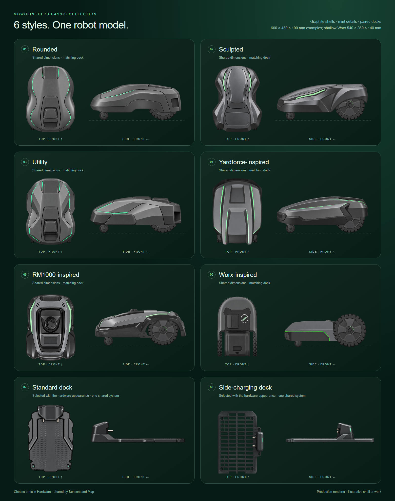

| Hardware | Transparent sensor editor |
| --- | --- |
| 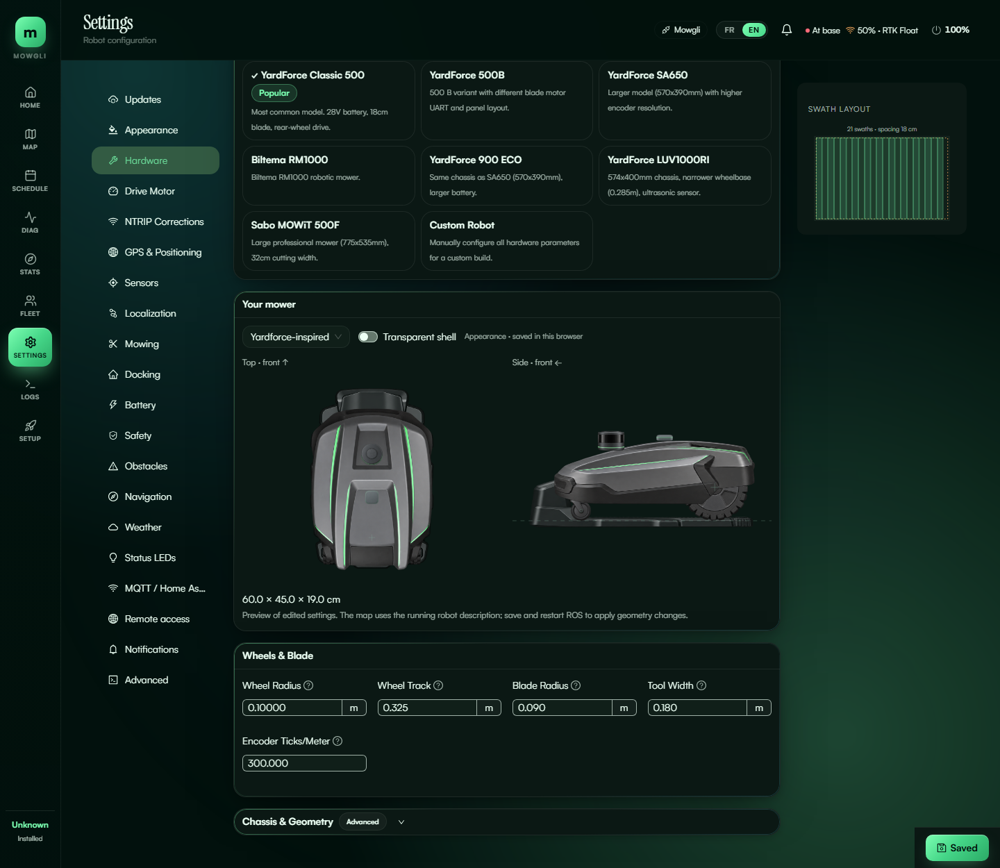 |  |
|  | 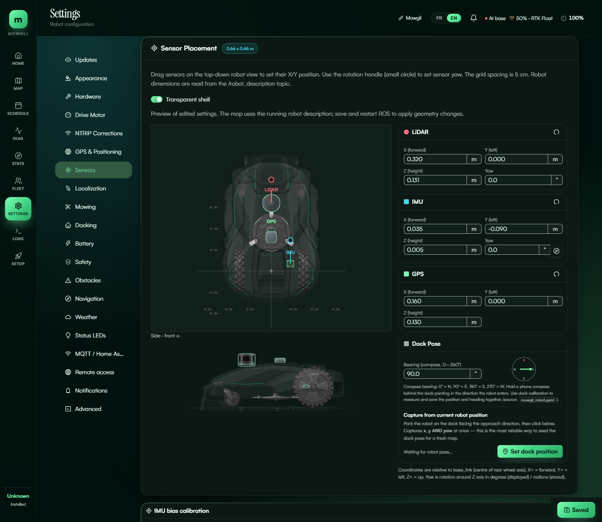 |
| 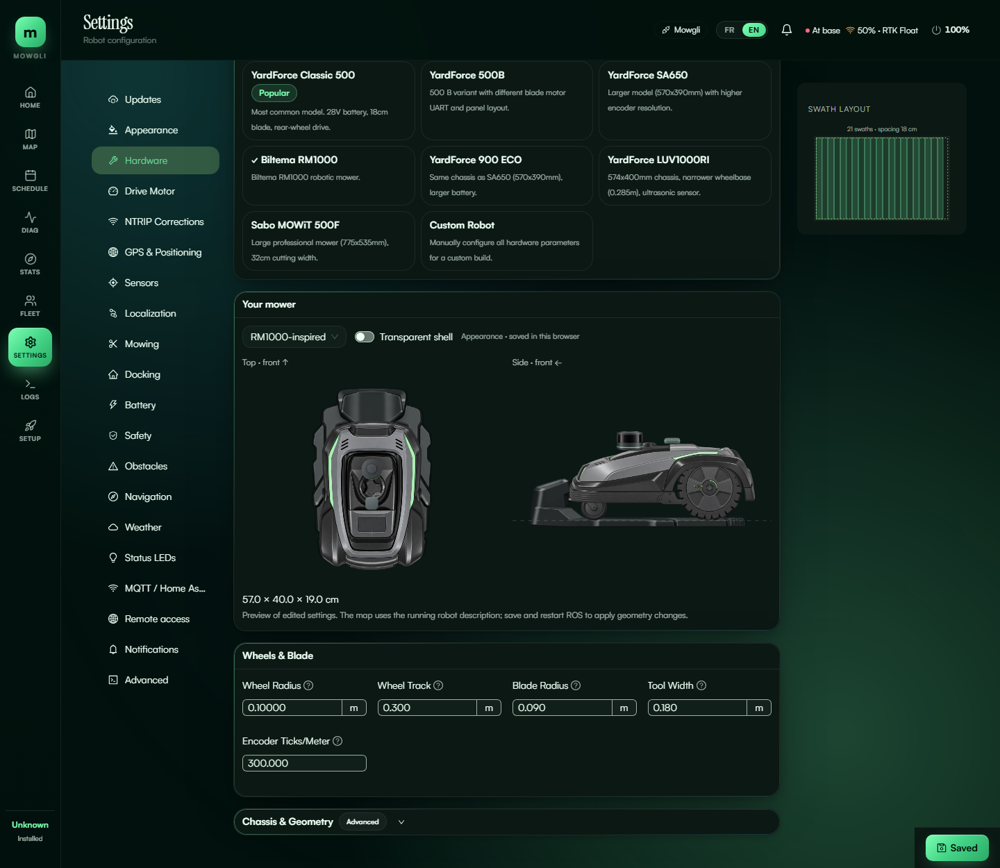 | 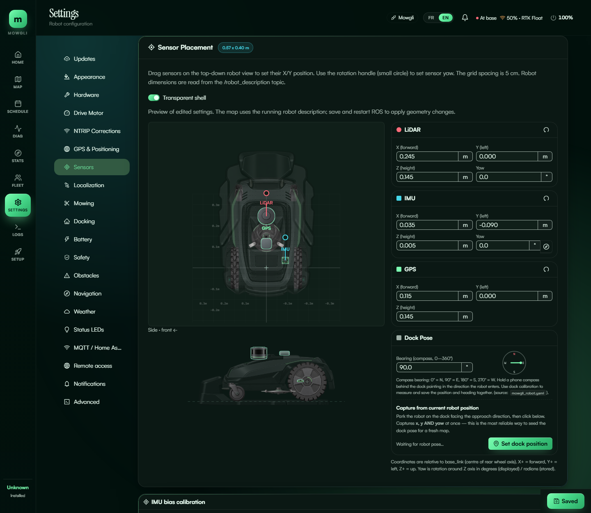 |
| 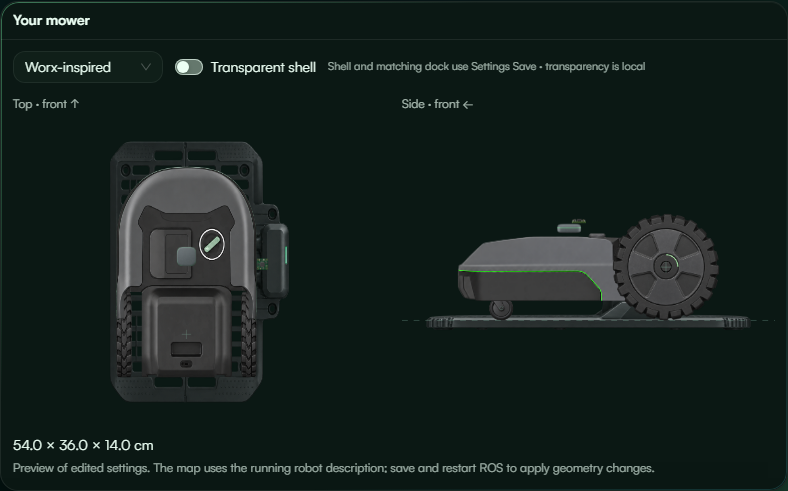 | 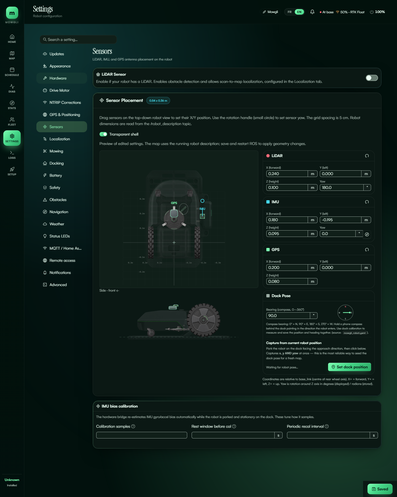 |

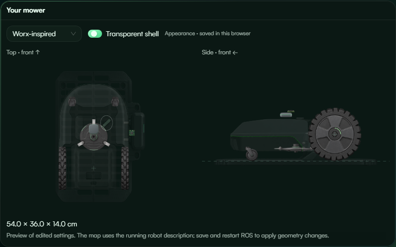

## Focused measurement editor

Implemented for 18 dimensional hardware fields. Desktop focus overlays the exact
endpoints, extension lines, arrows and value on the existing top or side preview.
The compact active preview stays above the fields while scrolling. Escape or
Close measurement dismisses it. Invalid input never labels a fallback preview as
the requested dimension.

On mobile, tapping a dimension opens a bottom-sheet dialog with the appropriate
projection, A/B endpoint labels, numeric input, units and the measurement help.
The sheet follows the visual viewport as the keyboard opens; its body scrolls
while Apply/Cancel remain accessible. The same dialog serves short touch screens.

**Apply** updates only the settings draft. **Cancel**, Escape and the close button
discard that dialog edit and restore focus to the field. Only the page's existing
**Save** persists changes. Invalid/out-of-range values disable Apply. No extra ROS
subscription, drive command, save or restart is introduced.

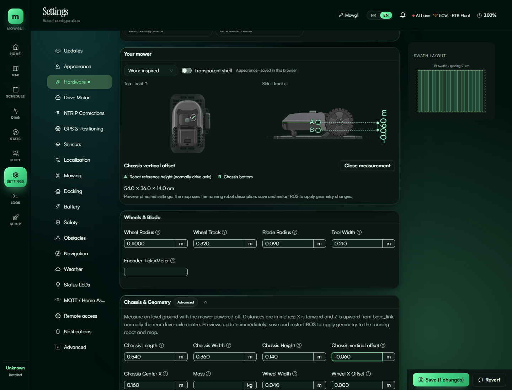
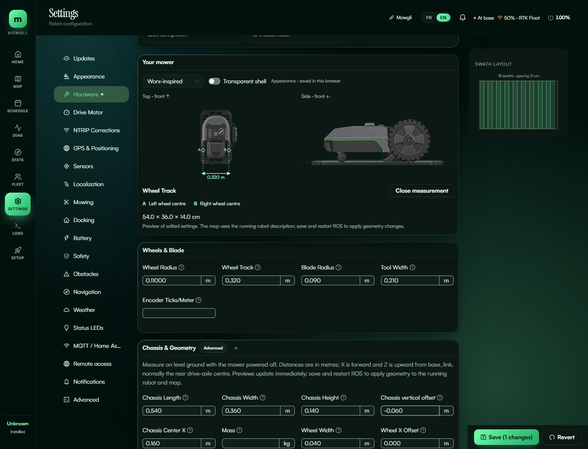
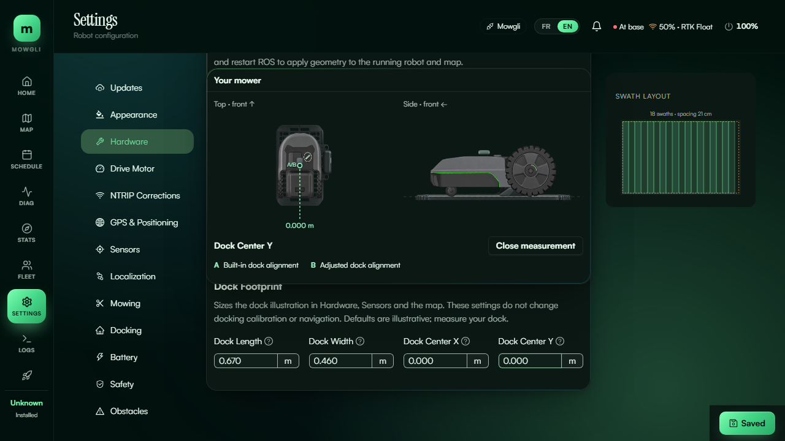

| Mobile side measurement | Mobile top measurement |
| --- | --- |
| 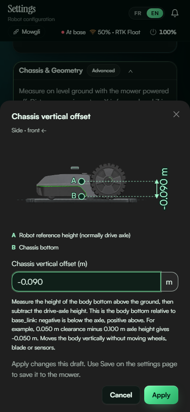 | 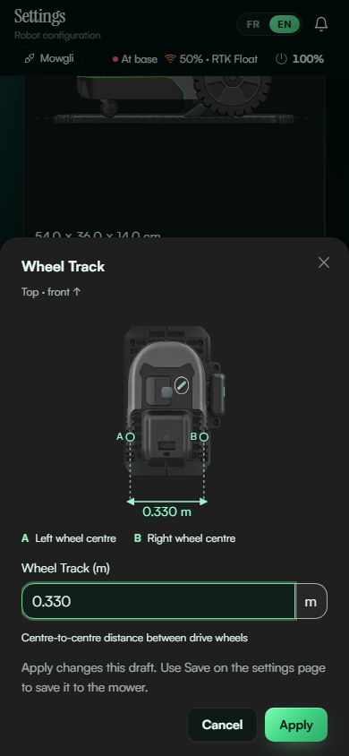 |

| Field | Projection | Measurement endpoints |
| --- | --- | --- |
| Chassis length / width | Top | Registered physical front/rear or left/right edges |
| Chassis height | Side | Shell bottom to top |
| Chassis bottom offset | Side | Rear axle height to shell bottom, signed |
| Chassis/caster front-back | Top or side | Rear axle line to chassis centre/caster axle |
| Wheel track | Top | Left wheel centre to right wheel centre |
| Wheel width | Top | Inner to outer tyre face |
| Wheel/caster radius | Side | Axle centre to tyre edge |
| Blade radius | Top | Disc centre to cutting envelope |
| Tool width | Top | Planned cutting swath, clearly distinct from disc radius |
| Dock length / width | Top | Complete registered footprint, including pedestal |
| Dock Center X / Y | Top | Built-in artwork reference to adjusted reference, signed |

A zero dock adjustment displays the built-in alignment correctly.
Changing numeric values updates the overlay immediately without saving or restarting
ROS. Sensor-specific dimensions can reuse the same interaction later. Mass and encoder counts keep their ordinary inputs because they have no spatial endpoints.

## Validation and limitations

Validation on 2026-10-11:
- Previous baseline a6c945e7: full frontend suite passed (973 tests, 119 files).
  Shared-configuration update: 46 focused appearance/rendering/locale tests pass.
  A broad rerun was stopped after excessive local runtime; no full-suite result is claimed for this update.
- TypeScript and lint pass (zero lint errors; existing warnings remain).
- 16 Hardware/Sensors/measurement/persistence browser cases and 9 map cases pass.
  Mobile checks cover Apply/Cancel/Escape, focus restoration, invalid input,
  viewport resizing and absence of automatic API writes.
- Production build verified before deployment.
- Current Go schema/default/generated-type and settings tests pass under Linux
  as a non-root user; configuration-drift check passes.
- Full ROS workspace build and physical geometry acceptance are not claimed.
  Browser mobile emulation is not a physical-phone/keyboard acceptance test.

Reproduce from gui/web using the repository's installed dependencies:

    npx tsc --noEmit
    npx vitest run src/components/robot src/utils/robotModel.test.ts src/hooks/useMowerVisual.test.tsx src/i18n/locales.test.ts
    npx playwright test tests/e2e/measurement-editor.spec.ts tests/e2e/layered-mower.spec.ts tests/e2e/layered-app-map.spec.ts tests/e2e/saved-mower-appearance.spec.ts --workers=2
    npx playwright test tests/e2e/layered-mower.spec.ts -g "Worx shallow" --workers=1

**HARDWARE_REQUIRED:** preset caster positions and chassis vertical offsets are
provisional physical geometry, not validated by artwork. Record the exact robot,
wheel type, running configuration, repository/URDF revision and firmware image.
With power off, blades removed and the mower stable on level ground, measure rear
axle-to-caster axle with casters forward, wheel centres/widths, and shell bottom/top
relative to the axle. Pass when configured geometry agrees within 5 mm; otherwise
use measured overrides and correct the preset. No motion is needed for this check.
See the component README for the existing Yardforce wheel-contour audit.
### Shared shell configuration

Body style and its matching dock are saved with Hardware settings in
`mower_visual_style`, shared across devices. Selection remains a draft until Save.
An empty setting follows the hardware model. Old browser shell preferences are
ignored rather than imported over mower configuration. Transparency remains a
local editing aid; Map always uses an opaque shell. Saving only appearance needs
no ROS restart. Regression coverage includes unsaved reload, save payload, a fresh
browser, Sensors and Map.

### Extensible artwork registry

All shell/dock choices, bilingual labels, pairings, source files, bounds, physical
frames, anchors, built-in offsets, map sizes and wheel layering now come from
`gui/web/src/components/robot/appearanceRegistry.ts`. Asset modules expose typed
views of that catalog; selectors and renderers do not repeat its ID lists.

To add an appearance, supply PNG artwork and registry metadata, then run
`npm run generate:appearances` in `gui/web`. It generates the backend shell enum
and compact map derivatives. Build checks validate image dimensions, atlas cells,
frames and references; tests enforce enum parity. A synthetic new shell/dock pair
is tested through resolution and both rendered views to catch hardcoded branches.
See the component README for the complete contributor workflow.

Registry cleanup validation: 7 registry/schema tests and 53 focused frontend
checks pass. All 29 browser checks (including four gallery captures) pass;
TypeScript and lint pass with zero errors and the unchanged warning baseline.
Existing compact assets regenerate byte-for-byte unchanged.
